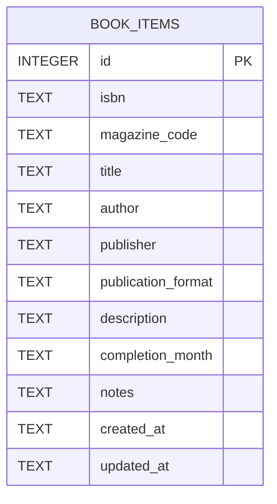
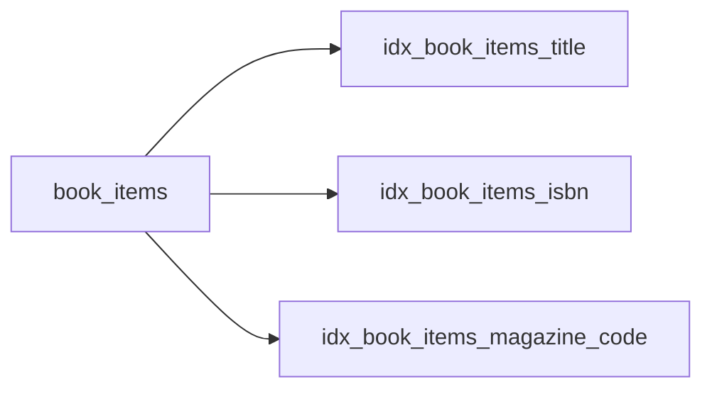
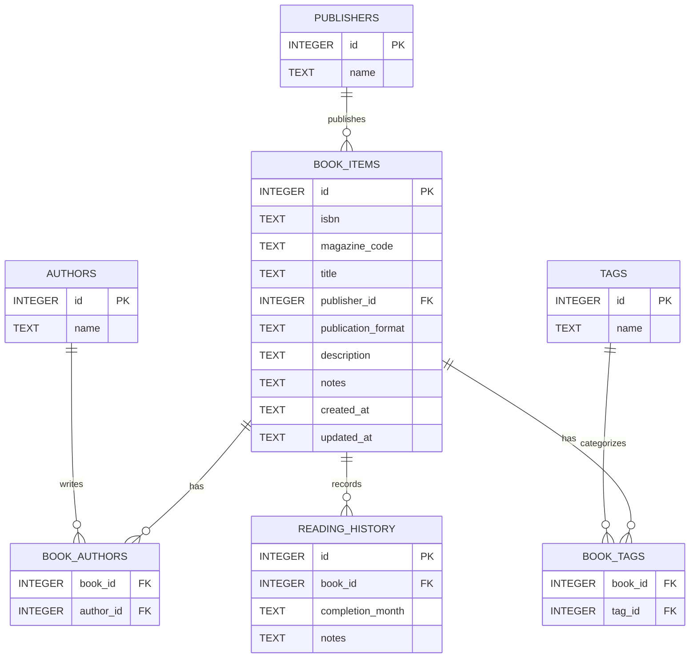

# ER図

Version : 0.1
Last Updated : 2026-07-17

---

## 1. 目的

この文書は、`book_manager` プロジェクトで使用するSQLiteデータベースのテーブル構造を、ER図と一覧で表したものです。

Version 0.1では、書籍情報を `book_items` 単一テーブルで管理します。

この文書は、次の資料として使用します。

* データベース設計の確認。
* SQLite初期化処理の実装。
* Repositoryの実装。
* データベース設計レビュー。
* 将来のテーブル追加や正規化の検討。

詳細なカラム仕様、保存形式、制約およびデータ操作方針は、`database_design.md` を参照します。

---

## 2. 対象Version

このER図は、データベース設計書Version 0.1に対応します。

```text
database_design.md : Version 0.1
er_diagram.md      : Version 0.1
```

ER図の内容を変更する場合は、原則として `database_design.md` も併せて確認します。

---

## 3. Version 0.1の構成

Version 0.1では、次の1テーブルを使用します。

```text
book_items
```

書籍、雑誌、文庫、単行本、ムック、コミックおよび電子書籍などを、同じテーブルで管理します。

著者、出版社、ジャンルなどは、Version 0.1では別テーブルへ分割しません。

---

## 4. ER図



Version 0.1ではテーブルが1つのみであるため、テーブル間のリレーションは存在しません。

---

## 5. テーブル構造図

```text
┌──────────────────────────────────────────┐
│                book_items                │
├──────────────────────────────────────────┤
│ PK  id                  INTEGER          │
│     isbn                TEXT NULL        │
│     magazine_code       TEXT NULL        │
│     title               TEXT NOT NULL    │
│     author              TEXT NULL        │
│     publisher           TEXT NULL        │
│     publication_format  TEXT NULL        │
│     description         TEXT NULL        │
│     completion_month    TEXT NULL        │
│     notes               TEXT NULL        │
│     created_at          TEXT NOT NULL    │
│     updated_at          TEXT NOT NULL    │
└──────────────────────────────────────────┘
```

---

## 6. テーブル一覧

| 論理名  | 物理名          | 役割                                |
| ---- | ------------ | --------------------------------- |
| 書籍情報 | `book_items` | 書籍や雑誌などの基本情報、読了年月、備考および管理日時を保存する。 |

---

## 7. カラム一覧

| 論理名   | 物理名                  | データ型    | NULL | キー  | 説明                       |
| ----- | -------------------- | ------- | ---- | --- | ------------------------ |
| ID    | `id`                 | INTEGER | 不可   | 主キー | レコードを一意に識別する。            |
| ISBN  | `isbn`               | TEXT    | 可    | なし  | ISBN-10またはISBN-13を保存する。  |
| 雑誌コード | `magazine_code`      | TEXT    | 可    | なし  | 雑誌コードを保存する。              |
| 書籍名   | `title`              | TEXT    | 不可   | なし  | 書籍名または雑誌名を保存する。          |
| 著者名   | `author`             | TEXT    | 可    | なし  | 著者名を文字列として保存する。          |
| 出版社   | `publisher`          | TEXT    | 可    | なし  | 出版社名を保存する。               |
| 出版形態  | `publication_format` | TEXT    | 可    | なし  | 文庫、単行本、電子書籍などを保存する。      |
| 内容紹介  | `description`        | TEXT    | 可    | なし  | 書籍や雑誌の内容紹介を保存する。         |
| 読了年月  | `completion_month`   | TEXT    | 可    | なし  | 読了年月を `YYYY-MM` 形式で保存する。 |
| 備考    | `notes`              | TEXT    | 可    | なし  | 利用者が入力する自由記述を保存する。       |
| 登録日時  | `created_at`         | TEXT    | 不可   | なし  | 登録日時をJSTで保存する。           |
| 更新日時  | `updated_at`         | TEXT    | 不可   | なし  | 最終更新日時をJSTで保存する。         |

---

## 8. 主キー

主キーは、`book_items.id` です。

```text
book_items.id
```

定義は次のとおりです。

```sql
id INTEGER PRIMARY KEY
```

SQLiteの `INTEGER PRIMARY KEY` を使用し、レコード追加時に自動採番します。

ISBNや雑誌コードは、次の理由から主キーにしません。

* ISBNが存在しない書籍を登録する可能性がある。
* 雑誌コードが存在しない書籍を登録する可能性がある。
* 同じISBNの書籍を複数冊所有する可能性がある。
* 同じ雑誌コードの資料を複数登録する可能性がある。
* 電子書籍や独自資料など、コードを持たない資料へ対応する必要がある。

---

## 9. 外部キー

Version 0.1では、外部キーを使用しません。

理由は、`book_items` 単一テーブルで構成されており、参照先となる別テーブルが存在しないためです。

将来、著者、出版社、ジャンル、タグなどを別テーブルへ分割した場合は、外部キーの追加を検討します。

---

## 10. 一意制約

Version 0.1では、ISBNおよび雑誌コードに一意制約を設定しません。

```text
isbn          : 重複可
magazine_code : 重複可
```

同じ書籍を複数冊所有している場合や、同じ雑誌を複数登録する場合を考慮します。

重複の可能性がある場合は、データベースで登録を禁止せず、ServiceまたはGUIで警告する方針です。

---

## 11. NULL許可

### 11.1 NULLを許可しないカラム

次のカラムは必須です。

```text
id
title
created_at
updated_at
```

### 11.2 NULLを許可するカラム

次のカラムは任意です。

```text
isbn
magazine_code
author
publisher
publication_format
description
completion_month
notes
```

任意項目へ空文字が入力された場合は、原則としてServiceで `NULL` へ変換してから保存します。

---

## 12. インデックス構成

Version 0.1では、次のインデックスを使用します。



| インデックス名                        | 対象カラム           | 目的                 |
| ------------------------------ | --------------- | ------------------ |
| `idx_book_items_title`         | `title`         | 書籍名検索を支援する。        |
| `idx_book_items_isbn`          | `isbn`          | ISBN検索と重複確認を支援する。  |
| `idx_book_items_magazine_code` | `magazine_code` | 雑誌コード検索と重複確認を支援する。 |

---

## 13. 日付および日時

### 読了年月

`completion_month` には、次の形式で保存します。

```text
YYYY-MM
```

例

```text
2026-07
```

### 登録日時と更新日時

`created_at` と `updated_at` には、次の形式で保存します。

```text
YYYY-MM-DD HH:MM:SS
```

例

```text
2026-07-17 15:30:00
```

日時はPython側で日本標準時として生成します。

SQLiteの `CURRENT_TIMESTAMP` は使用しません。

---

## 14. データ例

```text
┌────┬───────────────┬───────────────┬──────────────┬──────────┬────────────┐
│ id │ isbn          │ magazine_code │ title        │ author   │ publisher  │
├────┼───────────────┼───────────────┼──────────────┼──────────┼────────────┤
│ 1  │ 9784101010014 │ NULL          │ サンプル書籍 │ 山田太郎 │ サンプル社 │
└────┴───────────────┴───────────────┴──────────────┴──────────┴────────────┘
```

```text
┌────────────────────┬─────────────┬────────────────┬─────────────┐
│ publication_format │ completion  │ created_at     │ updated_at  │
├────────────────────┼─────────────┼────────────────┼─────────────┤
│ 文庫               │ 2026-07     │ 2026-07-17 ... │ 2026-07-17  │
└────────────────────┴─────────────┴────────────────┴─────────────┘
```

上記は説明用の例であり、実際の登録データではありません。

---

## 15. Version 0.1で正規化しない項目

Version 0.1では、次の項目を別テーブルへ分割しません。

```text
author
publisher
publication_format
```

例えば、著者が複数いる場合も、`author` カラムへ1つの文字列として保存します。

```text
山田太郎、鈴木花子
```

Version 0.1で単一テーブルを採用する理由は次のとおりです。

* 初期実装を小さく保てる。
* CRUD処理が単純になる。
* GUIとの対応関係が分かりやすい。
* 個人利用の規模では十分に管理できる。
* 必要性が明確になる前の過剰な正規化を避けられる。

---

## 16. 将来の正規化案

将来、著者別検索、タグ管理、読書履歴管理などが必要になった場合は、次のような構成を検討します。



この図は将来案であり、Version 0.1の実装対象ではありません。

---

## 17. 将来候補となるテーブル

将来、必要性が確認された場合は、次のテーブル追加を検討します。

| 候補テーブル              | 用途                 |
| ------------------- | ------------------ |
| `authors`           | 著者情報を管理する。         |
| `book_authors`      | 書籍と著者の多対多関係を管理する。  |
| `publishers`        | 出版社情報を管理する。        |
| `genres`            | ジャンルを管理する。         |
| `tags`              | 利用者定義のタグを管理する。     |
| `book_tags`         | 書籍とタグの多対多関係を管理する。  |
| `reading_history`   | 読了履歴や再読履歴を管理する。    |
| `ownership_items`   | 所有冊数や購入情報を管理する。    |
| `loan_history`      | 貸出履歴を管理する。         |
| `cover_images`      | 書影情報を管理する。         |
| `api_fetch_history` | 外部APIからの取得履歴を管理する。 |

これらは、実際の要件が発生するまで追加しません。

---

## 18. CREATE TABLE文との対応

ER図に対応する正式なテーブル定義は次のとおりです。

```sql
CREATE TABLE IF NOT EXISTS book_items (
    id INTEGER PRIMARY KEY,
    isbn TEXT,
    magazine_code TEXT,
    title TEXT NOT NULL,
    author TEXT,
    publisher TEXT,
    publication_format TEXT,
    description TEXT,
    completion_month TEXT,
    notes TEXT,
    created_at TEXT NOT NULL,
    updated_at TEXT NOT NULL
);
```

---

## 19. CREATE INDEX文との対応

```sql
CREATE INDEX IF NOT EXISTS idx_book_items_title
ON book_items(title);

CREATE INDEX IF NOT EXISTS idx_book_items_isbn
ON book_items(isbn);

CREATE INDEX IF NOT EXISTS idx_book_items_magazine_code
ON book_items(magazine_code);
```

---

## 20. 設計上の注意事項

### 20.1 ISBNと雑誌コード

ISBNと雑誌コードは任意項目であり、両方とも `NULL` のレコードを許可します。

コードが不明な書籍や独自資料でも、書籍名が入力されていれば登録できます。

### 20.2 書籍名

`title` は、Version 0.1で唯一の利用者入力上の必須項目です。

データベースでは `NOT NULL` を設定します。

空文字の禁止はServiceでも確認します。

### 20.3 著者名

複数著者を1つの文字列にまとめるため、著者単位の完全な検索や集計には適していません。

この制約は、Version 0.1の単純化として受け入れます。

### 20.4 出版形態

`publication_format` には、データベースのCHECK制約を設定しません。

選択可能な値はGUIで管理する予定です。

### 20.5 読了年月

読了年月は1つだけ保存するため、Version 0.1では再読履歴を複数記録できません。

再読履歴が必要になった場合は、`reading_history` テーブルへの分離を検討します。

### 20.6 物理削除

Version 0.1では論理削除カラムを設けません。

削除操作を行うと、対象レコードは `book_items` テーブルから物理的に削除されます。

---

## 21. 文書間の整合性

この文書を変更した場合は、次の文書への影響を確認します。

```text
docs/database/database_design.md
docs/database/database_design_review.md
docs/architecture/architecture.md
docs/ui/screen_specification.md
docs/tests/test_plan.md
```

特に、カラムの追加、削除、名称変更、NULL条件変更、制約変更を行った場合は、関連文書と実装の両方を更新します。

---

## 22. レビュー予定

このER図は、データベース設計書Version 0.1と併せてレビューします。

レビューでは、主に次の点を確認します。

* 必要なカラムが揃っているか。
* 主キーが適切か。
* 必須項目と任意項目が適切か。
* 単一テーブル構成で問題ないか。
* 正規化を延期して問題ないか。
* ISBNと雑誌コードの重複を許可して問題ないか。
* 読了年月を1つだけ保持する設計でよいか。
* 登録日時と更新日時が必要か。
* インデックス構成が適切か。
* 将来の機能追加を妨げないか。

---

## 23. Design Freeze予定

この文書のVersion 0.1は初回設計案です。

データベース設計レビューの結果を反映したVersion 0.2を、SQLite実装のDesign Freeze版とする予定です。

Design Freeze後にER図を変更する場合は、次の手順を行います。

```text
変更理由を整理する
↓
影響範囲を確認する
↓
database_design.mdを更新する
↓
er_diagram.mdを更新する
↓
必要に応じてADRを作成する
↓
レビューする
↓
Versionを更新する
↓
承認する
↓
実装とテストへ反映する
