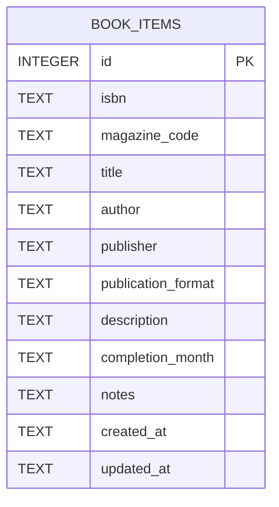
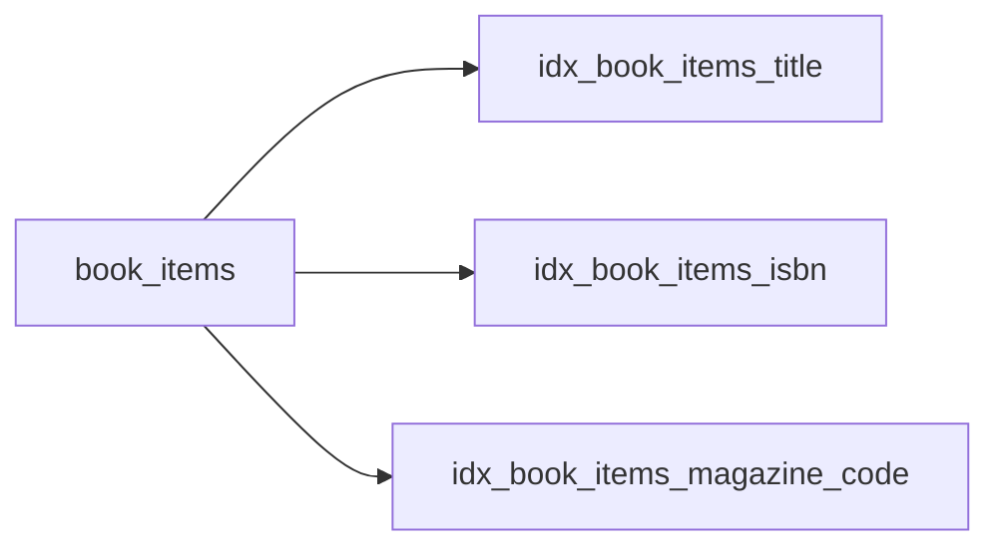
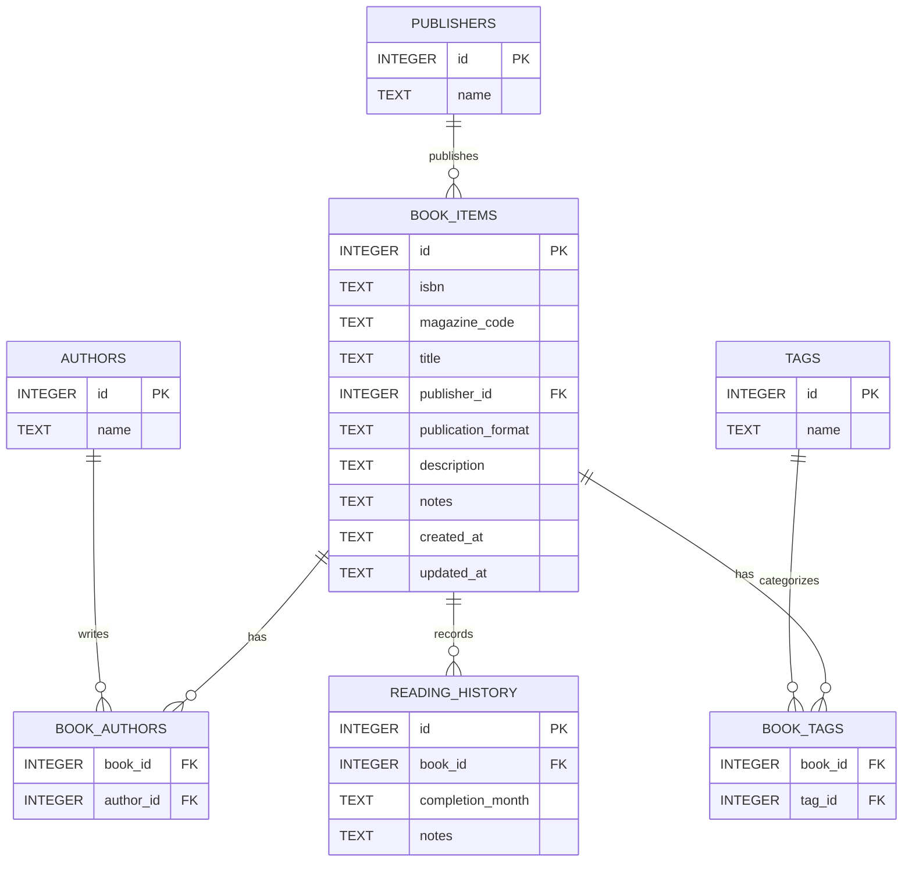

# ER図

Version : 0.2
Last Updated : 2026-07-17
Status : Design Freeze

---

## 1. 目的

この文書は、`book_manager` プロジェクトで使用するSQLiteデータベースのテーブル構造を、ER図と一覧で表したものです。

Version 0.1のアプリケーションでは、書籍情報を `book_items` 単一テーブルで管理します。

この文書は、次の資料として使用します。

* データベース構造の確認。
* SQLite初期化処理の実装。
* Repositoryの実装。
* Serviceの実装。
* データベース関連テスト。
* 将来のスキーマ変更の検討。

カラムの保存形式、入力検証、CRUD、スキーマVersionおよびエラー処理の詳細は、`database_design.md` を参照します。

---

## 2. 対象Version

このER図は、次の設計書に対応します。

```text
database_design.md : Version 0.2
er_diagram.md      : Version 0.2
SQLite user_version: 1
```

Version 0.2は、データベース設計レビューの結果を反映したDesign Freeze版です。

---

## 3. データベース構成

Version 0.1のアプリケーションでは、次の1テーブルを使用します。

```text
book_items
```

次の資料を、同じテーブルで管理します。

* 単行本。
* 文庫。
* 新書。
* 雑誌。
* ムック。
* コミック。
* 電子書籍。
* その他の書籍または資料。

Version 0.1では、著者、出版社、ジャンル、タグおよび読書履歴を別テーブルへ分割しません。

---

## 4. ER図



Version 0.1ではテーブルが1つだけであるため、テーブル間のリレーションはありません。

---

## 5. テーブル構造図

```text
┌──────────────────────────────────────────┐
│                book_items                │
├──────────────────────────────────────────┤
│ PK  id                  INTEGER          │
│     isbn                TEXT NULL        │
│     magazine_code       TEXT NULL        │
│     title               TEXT NOT NULL    │
│     author              TEXT NULL        │
│     publisher           TEXT NULL        │
│     publication_format  TEXT NULL        │
│     description         TEXT NULL        │
│     completion_month    TEXT NULL        │
│     notes               TEXT NULL        │
│     created_at          TEXT NOT NULL    │
│     updated_at          TEXT NOT NULL    │
└──────────────────────────────────────────┘
```

---

## 6. テーブル一覧

| 論理名  | 物理名          | 役割                         |
| ---- | ------------ | -------------------------- |
| 書籍情報 | `book_items` | 書籍、雑誌およびその他の資料に関する情報を保存する。 |

---

## 7. カラム一覧

| 論理名   | 物理名                  | データ型    | NULL | キー  | 説明                       |
| ----- | -------------------- | ------- | ---- | --- | ------------------------ |
| ID    | `id`                 | INTEGER | 不可   | 主キー | レコードを一意に識別する。            |
| ISBN  | `isbn`               | TEXT    | 可    | なし  | ISBN-10またはISBN-13を保存する。  |
| 雑誌コード | `magazine_code`      | TEXT    | 可    | なし  | 雑誌コードを保存する。              |
| 書籍名   | `title`              | TEXT    | 不可   | なし  | 書籍名または雑誌名を保存する。          |
| 著者名   | `author`             | TEXT    | 可    | なし  | 著者名を1つの文字列として保存する。       |
| 出版社   | `publisher`          | TEXT    | 可    | なし  | 出版社名を保存する。               |
| 出版形態  | `publication_format` | TEXT    | 可    | なし  | 文庫、単行本、電子書籍などを保存する。      |
| 内容紹介  | `description`        | TEXT    | 可    | なし  | 書籍や雑誌の内容紹介を保存する。         |
| 読了年月  | `completion_month`   | TEXT    | 可    | なし  | 読了年月を `YYYY-MM` 形式で保存する。 |
| 備考    | `notes`              | TEXT    | 可    | なし  | 利用者が入力する自由記述を保存する。       |
| 登録日時  | `created_at`         | TEXT    | 不可   | なし  | 登録日時をJSTで保存する。           |
| 更新日時  | `updated_at`         | TEXT    | 不可   | なし  | 最終更新日時をJSTで保存する。         |

---

## 8. 主キー

主キーは、次のカラムです。

```text
book_items.id
```

定義は、次のとおりです。

```sql
id INTEGER PRIMARY KEY
```

SQLiteの `INTEGER PRIMARY KEY` によって自動採番します。

`AUTOINCREMENT` は使用しません。

ISBNや雑誌コードは、次の理由から主キーにしません。

* ISBNが存在しない書籍がある。
* 雑誌コードが存在しない資料がある。
* 同じISBNを持つ書籍を複数登録できる必要がある。
* 同じ雑誌を複数登録できる必要がある。
* コードが不明な資料を登録できる必要がある。
* 電子書籍や独自資料を登録する可能性がある。

---

## 9. 外部キー

Version 0.1では、外部キーを使用しません。

`book_items` 単一テーブルで構成されており、参照先となる別テーブルが存在しないためです。

将来、著者、出版社、ジャンル、タグ、読書履歴などを分割した場合は、外部キーを追加します。

---

## 10. 一意制約

Version 0.1では、ISBNと雑誌コードに一意制約を設定しません。

```text
isbn          : 重複可
magazine_code : 重複可
```

同じ書籍を複数冊所有している場合や、同じ雑誌を複数登録する場合を考慮します。

重複時は、ServiceまたはGUIで警告します。

利用者が続行を選択した場合は登録できます。

---

## 11. NULL条件

### 11.1 NULLを許可しないカラム

```text
id
title
created_at
updated_at
```

### 11.2 NULLを許可するカラム

```text
isbn
magazine_code
author
publisher
publication_format
description
completion_month
notes
```

任意項目へ空文字が入力された場合は、ServiceでNULLへ変換してから保存します。

`title` は、NULLだけでなく空文字も禁止します。

空文字の検証はServiceで行います。

---

## 12. ISBNの保存ルール

ISBNは、TEXTとして保存します。

保存前に次の正規化を行います。

* 前後の空白を除去する。
* 半角空白を除去する。
* 全角空白を除去する。
* ハイフンを除去する。
* ISBN-10末尾の小文字 `x` を大文字 `X` に変換する。

例

```text
978-4-10-101001-4
```

保存値

```text
9784101010014
```

ISBN-10の例

```text
4-10-101001-x
```

保存値

```text
410101001X
```

不正なISBNは、警告後に利用者が続行を選択した場合のみ登録できます。

---

## 13. 雑誌コードの保存ルール

雑誌コードは、TEXTとして保存します。

保存前に前後の空白を除去します。

Version 0.1では、ハイフンの追加や除去などの自動整形は行いません。

重複検索は、保存値との完全一致で行います。

---

## 14. 出版形態

`publication_format` の初期選択肢は、次のとおりです。

```text
単行本
文庫
新書
雑誌
ムック
コミック
電子書籍
その他
```

未選択の場合はNULLとします。

データベースのCHECK制約は設定しません。

---

## 15. 日付および日時

### 15.1 読了年月

`completion_month` は、次の形式で保存します。

```text
YYYY-MM
```

例

```text
2026-07
```

### 15.2 登録日時と更新日時

`created_at` と `updated_at` は、次の形式で保存します。

```text
YYYY-MM-DD HH:MM:SS
```

例

```text
2026-07-17 15:30:00
```

日時は、Python側で日本標準時として生成します。

SQLiteの `CURRENT_TIMESTAMP` は使用しません。

---

## 16. インデックス構成

Version 0.1では、次の3つのインデックスを作成します。



| インデックス名                        | 対象カラム           | 目的                 |
| ------------------------------ | --------------- | ------------------ |
| `idx_book_items_title`         | `title`         | 書籍名検索と並び替えを支援する。   |
| `idx_book_items_isbn`          | `isbn`          | ISBN検索と重複確認を支援する。  |
| `idx_book_items_magazine_code` | `magazine_code` | 雑誌コード検索と重複確認を支援する。 |

著者名、出版社、出版形態および読了年月には、Version 0.1ではインデックスを作成しません。

---

## 17. データベーススキーマVersion

SQLiteのスキーマVersionは、次の値とします。

```text
PRAGMA user_version = 1
```

初期化処理では、テーブルとインデックスを正常に作成した後に設定します。

Version 0.1では複雑なマイグレーション処理を実装しません。

将来スキーマを変更するときに、現在のVersionを判断するために使用します。

---

## 18. 正式なCREATE TABLE文

```sql
CREATE TABLE IF NOT EXISTS book_items (
    id INTEGER PRIMARY KEY,
    isbn TEXT,
    magazine_code TEXT,
    title TEXT NOT NULL,
    author TEXT,
    publisher TEXT,
    publication_format TEXT,
    description TEXT,
    completion_month TEXT,
    notes TEXT,
    created_at TEXT NOT NULL,
    updated_at TEXT NOT NULL
);
```

---

## 19. 正式なCREATE INDEX文

```sql
CREATE INDEX IF NOT EXISTS idx_book_items_title
ON book_items(title);

CREATE INDEX IF NOT EXISTS idx_book_items_isbn
ON book_items(isbn);

CREATE INDEX IF NOT EXISTS idx_book_items_magazine_code
ON book_items(magazine_code);
```

---

## 20. スキーマVersion設定

```sql
PRAGMA user_version = 1;
```

---

## 21. データ例

次は、説明用のデータ例です。

| id | isbn            | magazine_code | title  | author | publisher |
| -: | --------------- | ------------- | ------ | ------ | --------- |
|  1 | `9784101010014` | NULL          | サンプル書籍 | 山田太郎   | サンプル社     |

| publication_format | completion_month | created_at            | updated_at            |
| ------------------ | ---------------- | --------------------- | --------------------- |
| 文庫                 | `2026-07`        | `2026-07-17 15:30:00` | `2026-07-17 15:30:00` |

実際の登録データではありません。

---

## 22. Version 0.1で正規化しない項目

Version 0.1では、次の項目を別テーブルへ分割しません。

```text
author
publisher
publication_format
```

複数著者も、1つの文字列として保存します。

例

```text
山田太郎、鈴木花子
```

単一テーブルを採用する理由は、次のとおりです。

* 初期実装を小さくできる。
* CRUD処理が単純になる。
* GUIとの対応が分かりやすい。
* 個人利用の規模では十分である。
* 過剰な正規化を避けられる。

---

## 23. 将来の正規化案

将来、著者別検索、タグ管理、再読履歴などが必要になった場合は、次の構成を検討します。



この図は将来案であり、Version 0.1の実装対象ではありません。

---

## 24. 将来候補となるテーブル

| 候補テーブル              | 用途                 |
| ------------------- | ------------------ |
| `authors`           | 著者情報を管理する。         |
| `book_authors`      | 書籍と著者の多対多関係を管理する。  |
| `publishers`        | 出版社情報を管理する。        |
| `genres`            | ジャンルを管理する。         |
| `tags`              | 利用者定義のタグを管理する。     |
| `book_tags`         | 書籍とタグの多対多関係を管理する。  |
| `reading_history`   | 読了履歴と再読履歴を管理する。    |
| `ownership_items`   | 所有冊数や購入情報を管理する。    |
| `loan_history`      | 貸出履歴を管理する。         |
| `cover_images`      | 書影情報を管理する。         |
| `api_fetch_history` | 外部APIからの取得履歴を管理する。 |

これらは、実際の要件が発生するまで追加しません。

---

## 25. 書影情報

Version 0.1の初期CRUDでは、書影情報を `book_items` テーブルへ保存しません。

次のカラムは設けません。

* 書影URL。
* 書影ファイルパス。
* 書影バイナリデータ。

将来書影を扱う場合も、画像データをSQLiteへ直接保存せず、キャッシュディレクトリの利用を基本とします。

---

## 26. バックアップ

Version 0.1の初期CRUDでは、バックアップ機能を必須としません。

ただし、将来バックアップ機能を実装することを考慮して、`backups` ディレクトリは維持します。

バックアップ実装時は、SQLiteのバックアップAPIを使用します。

---

## 27. 設計上の注意事項

### 27.1 ISBNと雑誌コード

ISBNと雑誌コードは任意項目です。

両方がNULLのレコードも登録できます。

コードが不明な書籍や独自資料であっても、書籍名が入力されていれば登録できます。

### 27.2 書籍名

`title` は、Version 0.1で唯一の利用者入力上の必須項目です。

データベースでは `NOT NULL` を設定します。

空文字はServiceで禁止します。

### 27.3 著者

複数著者を1つの文字列として保存するため、著者単位の完全な検索や集計には適していません。

この制約は、Version 0.1の単純化として受け入れます。

### 27.4 出版形態

`publication_format` には、CHECK制約を設定しません。

選択可能な値はGUIで管理します。

### 27.5 読了年月

読了年月は1つだけ保存します。

Version 0.1では、再読履歴を複数記録できません。

### 27.6 物理削除

Version 0.1では論理削除カラムを設けません。

削除操作を行うと、対象レコードは物理的に削除されます。

---

## 28. 文書間の整合性

この文書を変更した場合は、次の文書への影響を確認します。

```text
docs/database/database_design.md
docs/database/database_design_review.md
docs/architecture/architecture.md
docs/ui/screen_specification.md
docs/tests/test_plan.md
docs/adr/ADR-0001-sqlite-selection.md
```

次の変更を行う場合は、関連文書と実装をすべて確認します。

* カラムの追加。
* カラムの削除。
* カラム名の変更。
* データ型の変更。
* NULL条件の変更。
* 主キーの変更。
* インデックスの変更。
* テーブルの追加。
* スキーマVersionの変更。

---

## 29. Design Freeze

この文書のVersion 0.2を、SQLite初期実装のDesign Freeze版とします。

Version 0.2では、次の内容が確定しています。

* `book_items` 単一テーブル。
* 12カラム。
* `id INTEGER PRIMARY KEY`。
* `title TEXT NOT NULL`。
* ISBNと雑誌コードの重複許可。
* 任意項目のNULL許可。
* 3つのインデックス。
* JSTによる管理日時。
* `PRAGMA user_version = 1`。
* 書影カラムなし。
* 外部キーなし。
* 論理削除なし。

Design Freeze後にER図を変更する場合は、開発ガイドラインに従い、データベース設計書、レビュー記録、スキーマVersion、実装およびテストを更新します。
